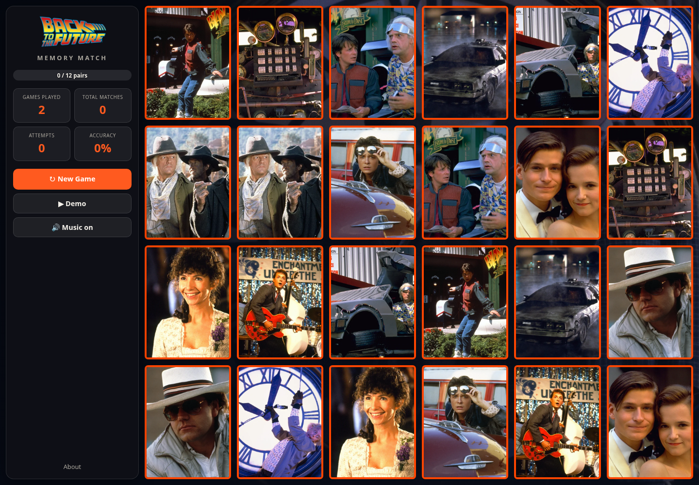

# Memory Match 🕰️

Flip 24 cards, find all 12 pairs, and don't let the Flux Capacitor down.

> "Roads? Where we're going, we don't need roads."
> — Doc Brown


## Features

- 🎴 **24 cards, 12 pairs**, all straight from the trilogy
- 📊 **Live stats**: games played, matches, attempts, and accuracy
- 🚗 **Win screen** with a DeLorean payoff
- 🎵 **Theme music** you can mute
- 📱 **Phone-friendly** layout

> "Great Scott!"
> — Doc Brown

> "Wait a minute, Doc. Are you telling me you built a time machine... out of a DeLorean?"
> — Marty McFly

## Quick start

```bash
npm install
npm run dev      # local dev server
npm run build    # production build in dist/
npm test         # run the test suite
```

The About page lives at `#/about`.

## Artwork

The 12 matching images are cropped from the official trilogy galleries: Marty at
Enchantment Under the Sea, Doc at the clock tower, the DeLorean, the hoverboard,
and other recognizable characters and moments. The night-time clock-tower
background has a dark overlay to keep the board and stats readable.

All refreshed images are bundled locally as optimized WebP files (640 × 640 for
cards, 1920 × 1080 for the background), with no runtime third-party image requests.


Full source pages, original image URLs, crop centers, and rights notes are in
[`public/images/refresh/credits.json`](public/images/refresh/credits.json).
Attribution does not grant a license: the images remain copyrighted by their
respective rights holders and are not represented as openly licensed.

## Built with

React + Vite. Originally written in AngularJS + jQuery.

---

*Fan project. Back to the Future is property of its respective owners.*
